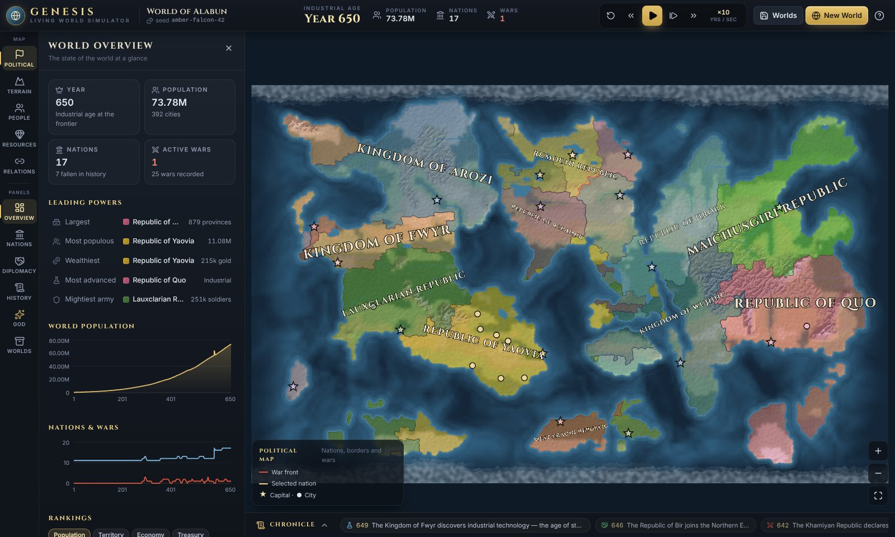
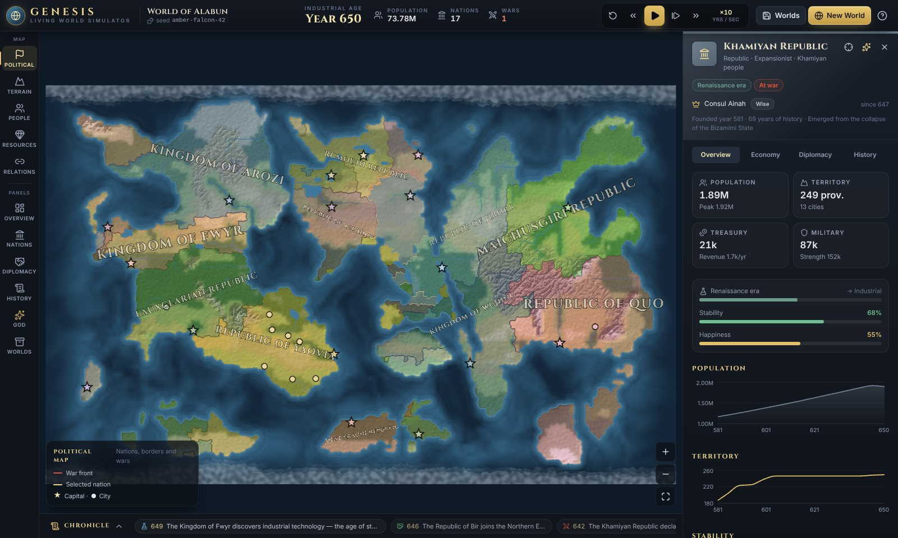
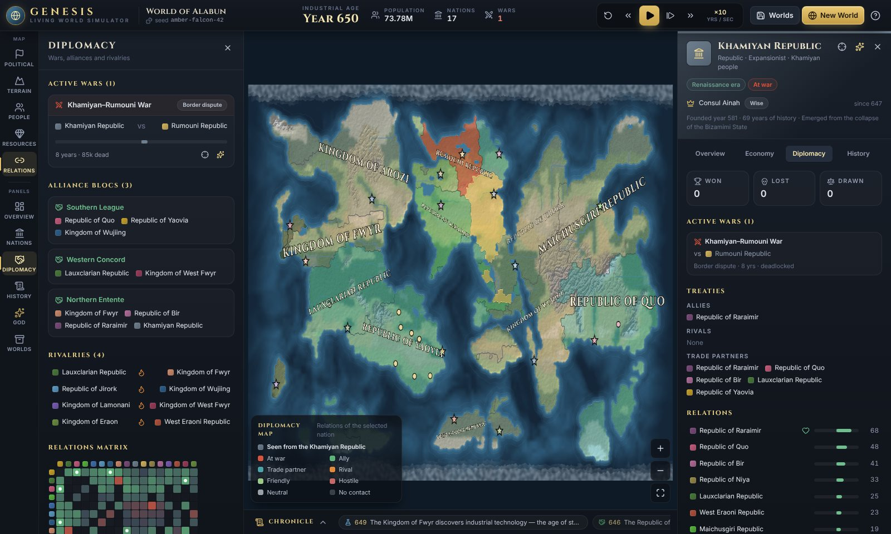
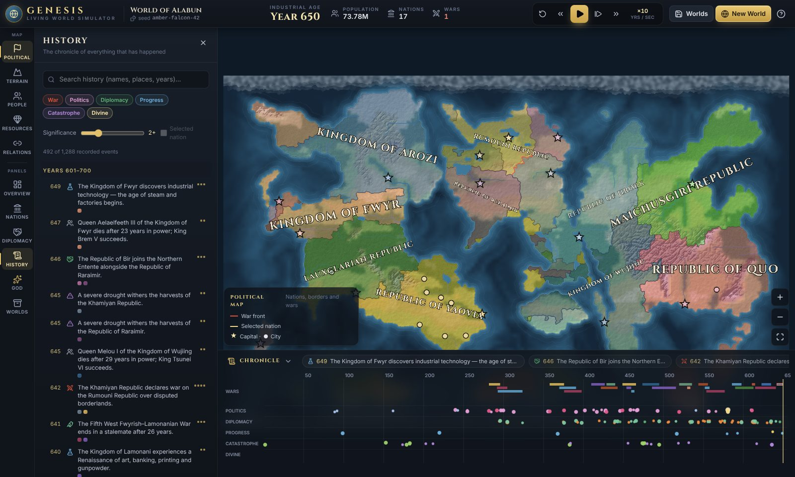
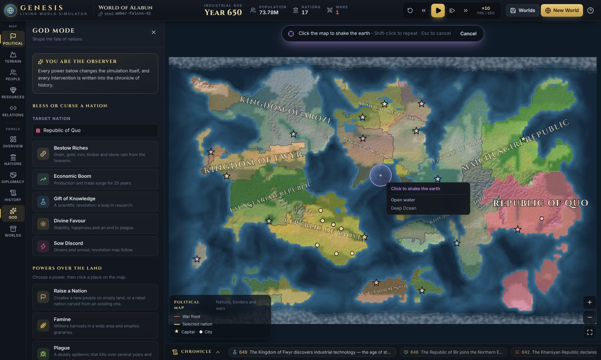
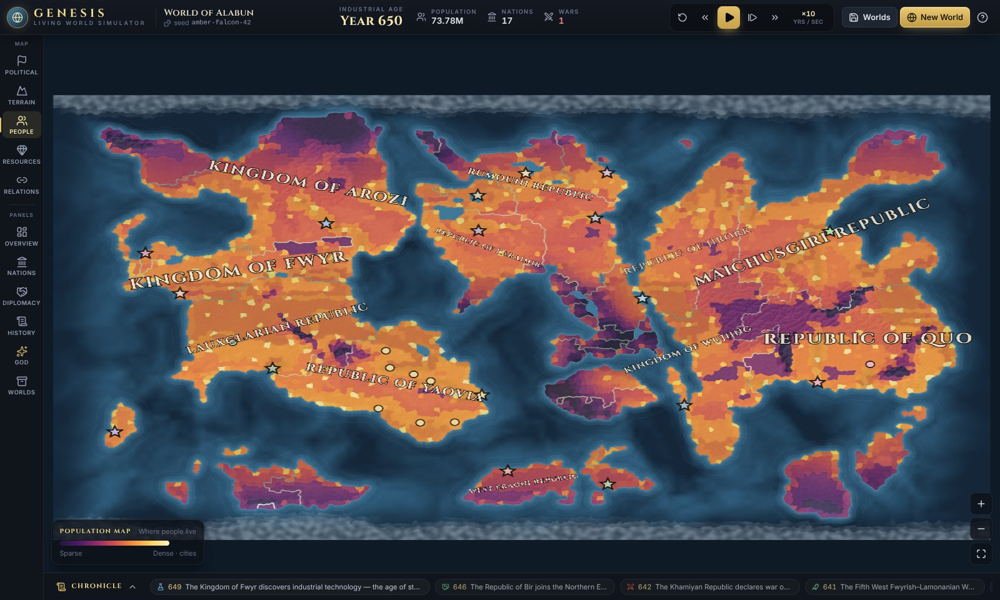
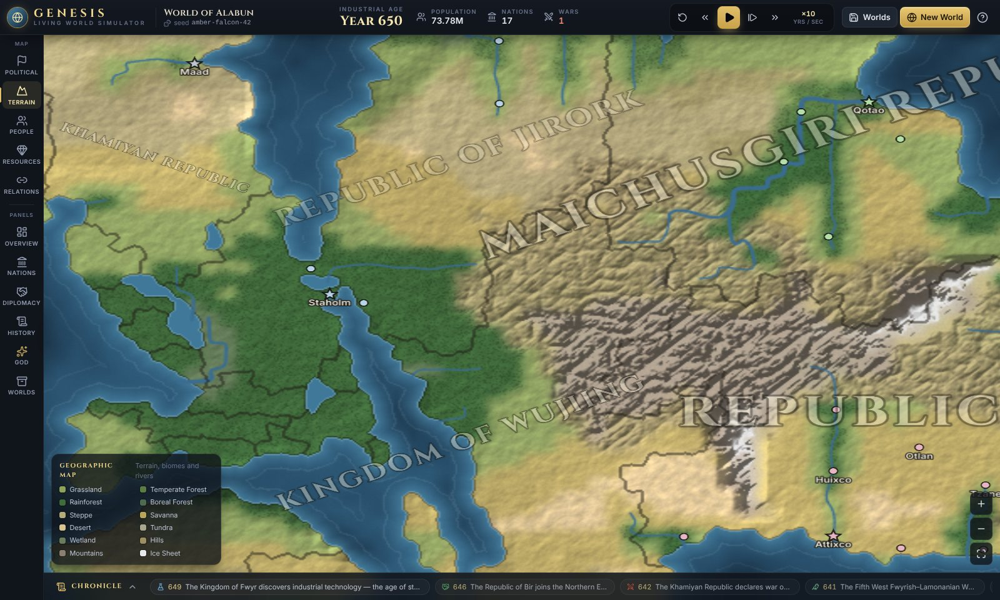

# GENESIS — a living civilization simulator

GENESIS generates a world, seeds it with a dozen peoples, and lets history happen. Nations settle the land, found cities, trade, form alliance blocs, fall out over borders and resources, go to war, suffer famine and plague, overthrow their rulers, split apart in civil war, collapse into successor states and, sometimes, rise again centuries later. You don't rule any of them. You watch, inspect everything, and step in as a god when you feel like it.

Everything runs in your browser. There's no backend, no API keys and no paid service, and every event in the chronicle comes from a rule in the simulation, not from random flavour text.



| | |
|---|---|
|  |  |
|  |  |
|  |  |

## Quick start

You need Node.js 20.19 or newer (Node 22 recommended).

```bash
npm install
npm run dev        # open the URL Vite prints (http://localhost:5173)
```

Other commands:

```bash
npm test           # Vitest suite: 1000-year smoke test, invariants, deterministic replay, save/load, God Mode
npm run build      # type-check (strict) + production build into dist/
npm run preview    # serve the production build locally
npm run simulate -- --seed amber-falcon-42 --years 1000   # run a world headless and print its chronicle
```

Add `?seed=<anything>` to the URL to open a specific world, for example `http://localhost:5173/?seed=amber-falcon-42`.

## How to play

When you first open GENESIS it generates a world and shows a short introduction. Press **Let history begin**, or <kbd>Space</kbd>.

| Action | How |
|---|---|
| Play / pause | <kbd>Space</kbd> or the gold button |
| Advance one year (while paused) | <kbd>.</kbd> or <kbd>→</kbd> (<kbd>Shift</kbd> for ten years) |
| Speed (1 to 80 years per second) | <kbd>+</kbd> / <kbd>-</kbd> |
| Reset the world to year 1 (same seed) | ↺ in the time controls |
| Zoom / pan | mouse wheel or pinch / drag |
| Inspect a nation or a place | click the map |
| Map modes | <kbd>1</kbd> Political · <kbd>2</kbd> Terrain · <kbd>3</kbd> Population · <kbd>4</kbd> Resources · <kbd>5</kbd> Relations |
| Panels | <kbd>O</kbd> Overview · <kbd>N</kbd> Nations & archive · <kbd>D</kbd> Diplomacy · <kbd>H</kbd> History · <kbd>G</kbd> God Mode |
| Chronicle timeline | <kbd>T</kbd> |
| Focus the selected nation | <kbd>F</kbd> |
| Cancel a God Mode tool / close | <kbd>Esc</kbd> or right-click |

### What you'll see

- **World map.** Painted terrain with relief shading, coastal shallows, rivers, lakes and polar ice. Nations are drawn as translucent overlays with two-tone borders, red war fronts and a gold outline for the selected nation. Nation names are placed and rotated like an atlas, and cities and capitals appear as you zoom in. Events flash on the map as pings.
- **Overview.** Year, population, nations, wars, the leading powers (largest, most populous, wealthiest, most advanced, mightiest army), world population and wars-over-time charts, rankings by seven metrics, the spread of technological ages, and recent major events.
- **Nations.** Living nations, sortable and searchable, plus an **archive** of every fallen nation with its lifespan and fate. Fallen nations stay fully inspectable.
- **Diplomacy.** Active wars (combatants, cause, duration, casualties, war score), alliance blocs, rivalries, a relations matrix, and recent peace treaties with their outcomes.
- **History.** A searchable, filterable chronicle (by category, significance and nation).
- **Chronicle timeline.** The whole of history on one strip: wars as bars, plus political, diplomatic, progress and catastrophe markers. Click any of them to jump to it.
- **Inspector.** For any nation: government, personality, current ruler and trait, founding, age, era progress, stability, happiness, population, territory, cities, treasury, army, stockpiles and shortages, budget, allies, rivals, trade partners, wars, relations, accomplishments, a nation-specific timeline, and charts of how all of these changed over time. It updates live while time flows.

### God Mode

- **Nation powers:** Bestow Riches, Economic Boom, Gift of Knowledge (scientific revolution), Divine Favour, Sow Discord.
- **Map powers:** pick one, then click the map. A preview shows the area affected. Raise a Nation (on empty land, or as a rebel state carved out of an existing one), Famine, Plague, Earthquake, Great Flood.
- **War and peace:** compel any nation to attack another, or impose peace on any war.

Every intervention changes the simulation and is recorded in the history log and in the world's replay log.

### Saving

Open the **Worlds** panel (the save icon in the top bar).

- **Save new**, **Overwrite** and **Delete** manage saves in this browser. Saves live in IndexedDB, so you can keep several worlds.
- **Export JSON** downloads a world file. **Import world file** loads one back and validates it first.
- Save files are versioned (`format: "genesis-world"`, `version: 1`). They hold the whole state, including the random generator's position, so a loaded world continues exactly as it would have.
- You're asked to confirm before overwriting, deleting, or replacing a world that has unsaved history.

## Determinism

The same seed with the same interventions applied in the same years always produces the same history, down to the last digit:

- Every random decision comes from one seeded SFC32 generator stored in the world. Simulation code never calls `Math.random()`.
- Time advances in fixed one-year steps, in a fixed order of systems.
- Divine interventions run between steps and are recorded with their year, so they can be replayed (`advance(world, years, commandLog)`).
- Saving and loading preserve the generator state and rebuild every derived cache from the saved state.

The test suite checks all of this: two identical runs, a replay of a recorded command log, and save → load → continue against an uninterrupted run all produce identical fingerprints. Floating-point results are only guaranteed identical within the same JavaScript engine.

## Project layout

```
src/
  simulation/   pure engine: genesis, economy, expansion, technology, diplomacy, war,
                politics, disasters, God Mode commands, invariants, stats, save files
  world/        procedural terrain: noise, continents, climate, rivers, lakes, biomes, resources
  rendering/    PixiJS map renderer, terrain painter, overlays, labels, camera
  components/   React interface (top bar, rail, panels, inspector, timeline, dialogs)
  store/        Zustand state, simulation loop controller, IndexedDB persistence
  types/        shared type definitions
  utils/        seeded RNG, noise, names, colours, formatting, heap
  tests/        Vitest suites
scripts/        headless simulation CLI
```

[ARCHITECTURE.md](ARCHITECTURE.md) explains how each system works. [ROADMAP.md](ROADMAP.md) lists ideas for the future.

## Deploying to GitHub Pages

The workflow in `.github/workflows/deploy.yml` runs the tests and the production build on every push and pull request. It publishes to GitHub Pages on every push to `main` (or `master`) and whenever you run it by hand. To turn it on:

1. On GitHub, open **Settings → Pages** and set **Source** to **GitHub Actions**.
2. Open the **Actions** tab, choose **CI & GitHub Pages**, and press **Run workflow** on the branch you want to publish. From then on, every push to `main` publishes automatically.
3. The site appears at `https://<user>.github.io/<repo>/`.

GitHub only lets the `github-pages` environment deploy from the branches its protection rules allow (by default, the default branch). To publish from another branch, add it under **Settings → Environments → github-pages**.

The build uses relative asset paths (`base: './'`), so it works under any sub-path and on any static host.

## Tech stack

React 19, TypeScript (strict), Vite 7, PixiJS 8, Zustand 5, Tailwind CSS 4, Recharts 3, Vitest 5, lucide-react icons, and self-hosted Inter and Cinzel fonts from Fontsource. There are no external runtime services.

## Browser support

GENESIS needs a recent desktop browser with WebGL (Chrome, Edge, Firefox or Safari). It works on tablets and phones too, though with a simplified layout. If WebGL isn't available, the app says so and the simulation keeps running.

## License

MIT. See [LICENSE](LICENSE).
